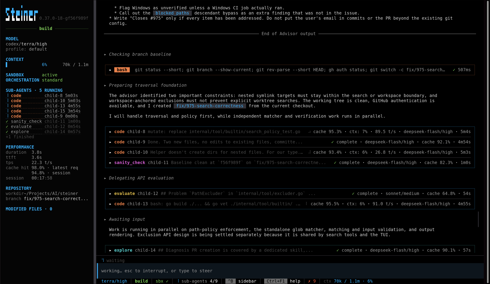

# steiner

Steiner is a terminal-based coding agent with a rich TUI. Its main operating principle is built around the concept of sub-agent orchestration to drive its built-in workflows for problem-solving while keeping quality high and costs down by ensuring users can fully utilise various tiers of AI models (from frontier reasoning types to flash-level).

It's built in Go and distributed as a single, compact binary that can update itself.

Steiner's not a vibe-coder's tool; it's a systems engineer's assistant for getting real work done with quality results.



## Providers, models and delegation

Works with subscriptions (Codex, OpenCode Go, Claude Code) and regular API access (OpenAI, Anthropic, OpenRouter, LM Studio...). You could combine, say, a Claude Code Pro subscription to gain access to Opus for your planning and thinking tasks while executing the work with DeepSeek Flash via an OpenCode Go subscription, or Qwen 27b running locally somewhere in your homelab.

Assign models to exploration, implementation and review through [model profiles](docs/user/provider-and-model-setup.md): anything from trillion-parameter uber-hype AI lab models from your monthly subscription all the way down to open-weight models run locally or by other, smaller providers, all in the same session. Steiner's main agent, the orchestrator, breaks down work into narrowly-scoped tasks to be worked on by [sub-agents](docs/user/sub-agent-delegation.md) then has the work reviewed, checked and integrated.

An optional [advisor](docs/user/advisor.md) can be made available to the orchestrator and sub-agents to provide them with strategic guidance and give mid-tier and smaller models access to frontier-level reasoning.

Sub-agents are asynchronous by nature - a bunch can be spawned at the same time, and once they're dispatched, the main orchestrator is free to do other work until results come back. You're free to converse with it while work is getting done to steer it or seek clarification on what's happening.

## Working on changes

Work conversationally, use structured planning and review skills, or run a well-specified task unattended. See [How to work with steiner](docs/user/workflows.md).

Agent skills are supported, and only injected when invoked (many agents bloat their context with skill slugs and descriptions to allow models to invoke them by themselves). Bundled [skills](docs/user/skills.md) cover implementation, review, simplification and security audits.

## Tools and sessions

[Interactive sessions](docs/user/interactive.md) support resume, forks and pasted images. There's a command-line exec mode to allow integration into other tools as part of a workflow.

Steiner's built-in tools cover all of the basics for file-finding, traversal, reading, editing and scripting, in a safe manner that keeps the agent's context from bloating.

It also supports web searches via various providers, like SearxNG (run locally or hosted), Brave API and others.

There's also support for [MCP servers](docs/user/mcp.md) for integrating external tooling, as well as [LSP](docs/user/lsp.md) for code navigation.

## Context and provider prompt caching

Steiner keeps its own context overhead low. The system preamble and agent guidance are kept as brief as possible while ensuring models have clear operating guidelines. They stay stable alongside tool definitions so providers can cache them between turns.

Tool output is capped with a myriad of tricks to ensure economical and predictable token usage - truncation, pagination and limits alongside guidance on how to retrieve more if needed. See [context management](docs/user/context-management.md) and [usage statistics](docs/user/usage.md).

Steiner puts a lot of effort into ensuring it hits as much of the provider cache as possible, and surfaces caching information for users to make sure they're being as efficient with their costs as possible.

## Quick start

Install with Go, or see [installation](docs/user/installation.md) for release binaries:

```bash
go install github.com/luispabon/steiner/cmd/steiner@latest
```

Configure a provider and model using the [quickstart](docs/user/quickstart.md), then run in your project:

```bash
steiner
```

## Safety

Steiner's model is not to stop the coding agent from doing any work. You will very rarely see tool approval dialogs, dialogs we all know nobody reads after the third or fourth one, and that you've already disabled by day 5.

Our approach is different: by default, a sandbox is enabled (currently Linux-only) where your filesystem is available read-only, and the workspace is read-write. Most of the environment is also masked from Steiner, so API keys and the like aren't passed through.

See [sandboxing and approvals](docs/user/sandboxing.md).

## Documentation

- [Quickstart](docs/user/quickstart.md)
- [User manual](docs/index.md)
- [Internals](docs/internals/index.md)
