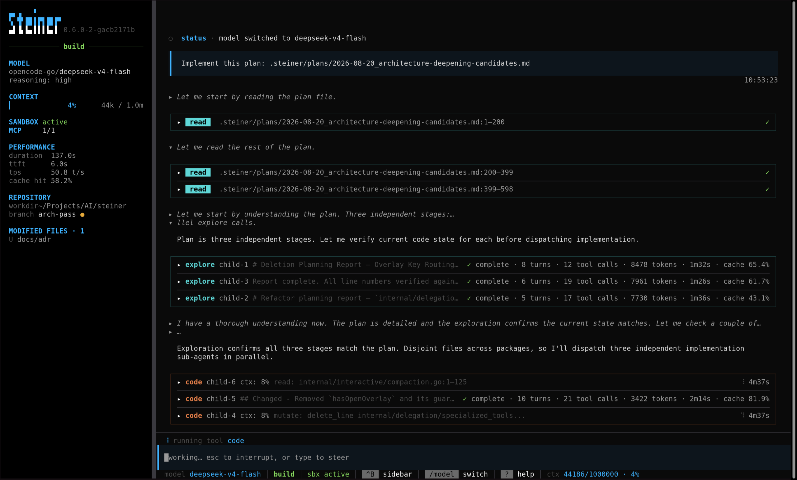

# steiner

A minimal, local-first Go coding agent with bounded context and sandboxed execution.

## Quick start

[Install a release binary](docs/user/installation.md), then see [Getting started](docs/user/getting-started.md) for the shortest local-model path. [Provider and model setup](docs/user/provider-and-model-setup.md) covers provider connections and model references. [CLI reference](docs/user/cli.md) covers one-shot requests, commands, and interactive controls.

## Features

- Local and cloud providers with one configuration shape, including the unofficial Claude subscription provider. See [Configuration](docs/user/configuration.md) and [Claude subscription](docs/user/claude-subscription.md).
- Bounded context through delegation, budgets, and compaction, with archived pre-compaction history for interactive and oneshot phase runs. See [Context management](docs/user/context-management.md).
- Async sub-agents: in interactive sessions `sub_agent` and `follow_up` return an ack immediately and each result arrives later as a separate message, so you can keep talking to the orchestrator while the conversation shows a Waiting state. In async sessions, calls sharing a `group` label deliver their results together; blocking calls return per-call. See [Sub-agent delegation](docs/user/sub-agent-delegation.md).
- Structured tools, optional language-server and MCP integrations. Read output omits line numbers by default; set `line_numbers: true` to include them. Bash output is previewed within `max_output_bytes`, with the output saved to a private artifact when cut (the artifact may be partial), and grep pages results with `next_offset`. See [Tools](docs/user/tools.md), [LSP](docs/user/lsp.md), and [MCP](docs/user/mcp.md).
- Plan/build execution modes and resumable autonomous runs. See [Execution modes](docs/user/execution-modes.md) and [Oneshot](docs/user/oneshot.md).
- Static, read-only security audits of a diff or repository, with adversarial verification. See [Security audit](docs/user/security-audit.md).
- Sandboxed commands by default. See [Sandboxing](docs/user/sandboxing.md).
- Model and profile pickers on `alt+m` and `alt+p`, usable with a draft or during a run. Switching models in a conversation asks for confirmation, since it invalidates the prompt cache. See [Provider and model setup](docs/user/provider-and-model-setup.md).
- Internal error log: recent TUI developer errors, shown with `alt+e` or `/errors`, with a status badge for unseen entries. Optional `internal` diagnostics stream. See [Configuration](docs/user/configuration.md#diagnostics-block).
- Optional advisor, model discovery, image input, notifications, and cache statistics. See [Optional features](docs/user/optional-features.md).

## Safety

Review configuration before real work. Commands are sandboxed by default on Linux, but sandboxing is not a confidentiality boundary. `--unsafe` disables the sandbox. See [Sandboxing](docs/user/sandboxing.md). The first time steiner runs in a project directory, it asks you to trust that project, showing every way its `.steiner/config.yaml` would change your global config. See [Project trust](docs/user/configuration.md#project-trust).

## Subscription usage dashboard

Press `ctrl+o` or run `/usage` in the interactive TUI to see rate-limit windows and spend budgets for your Codex, Claude subscription, OpenCode Go, OpenRouter, and LiteLLM accounts. Each window with enough history shows a trend toward its limit. The dashboard refreshes on open, from passive provider traffic, and after runs. See [Subscription usage dashboard](docs/user/usage-dashboard.md).

## Documentation map

- [Documentation home](docs/index.md)
- [User documentation](docs/index.md#user-documentation)
- [Internals](docs/internals/index.md)

## Contributing

Run `make check` before submitting changes. Contributor rules and architecture constraints are in [AGENTS.md](AGENTS.md).
