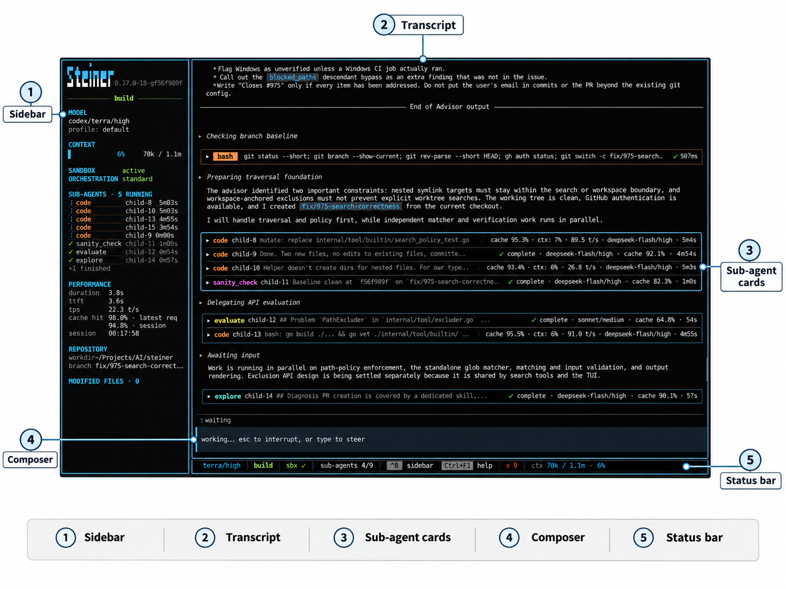

# Interactive mode

Run `steiner` with no arguments to start the interactive terminal UI (TUI). For command-line flags and subcommands, see [CLI reference](cli.md).

## Layout

- **Transcript**: the main pane. It shows your messages, model replies, thinking blocks, tool calls, approval prompts and sub-agent cards.
- **Composer**: the input box at the bottom. Queued messages appear in a box above it.
- **Status bar**: below the composer. It shows the model, context usage, the execution mode and key hints. Context usage reads `ctx --` until a model request reports usage together with a usable context window, and stays `ctx --` if no usable window is reported; after that it shows used / budget tokens with a percentage.
- **Sidebar**: model and profile, context gauge, sandbox status, orchestration level, active skill, MCP and LSP server counts, sub-agents, performance, session start and active runtime, repository branch and modified files. When a newer release is available, the sidebar shows `↑ <version> · upgrade` (see [Installation](installation.md)). Press `ctrl+b` to show or hide it. It is hidden when the terminal is narrower than 100 columns.



## Key bindings

Open the help overlay with `ctrl+f1` for a short list of key bindings.

### Composer

| Key | Action |
|-----|--------|
| `enter` | Submit. During a run, queue the text as a steer (see [Steering a run](#steering-a-run)) |
| `shift+enter`, `alt+enter`, `ctrl+j` | Insert a newline |
| `up` / `down` | Recall earlier prompts when the cursor is on the first row; otherwise move the cursor |
| `/` | Open the slash overlay of commands and skills (when the composer is empty) |
| `tab` | Cycle completions for a slash command |
| `@` | Open the file picker; `enter` or `tab` inserts the selected path, `esc` cancels |
| `ctrl+a` / `ctrl+e` | Move to line start / end |
| `ctrl+k` | Delete to end of line |
| `ctrl+w` | Delete the previous word |
| `ctrl+u` | Delete to start of line |
| `ctrl+v` | Paste an image (see [Images](#images)) |

### Session and view

| Key | Action |
|-----|--------|
| `ctrl+b` | Toggle the sidebar |
| `ctrl+t` | Open the context overlay |
| `ctrl+o` | Open or close the usage dashboard (`r` refreshes; see [Usage](usage.md)) |
| `ctrl+x` | Expand or collapse the latest delegation output |
| `ctrl+g` | Take queued steers back into the composer |
| `shift+tab` | Toggle between plan and build mode (see [Execution modes](working-with-steiner.md#plan-and-build-modes)) |
| `alt+m` | Open the model picker |
| `alt+p` | Open the profile picker |
| `alt+e` | Open or close the error log |
| `alt+a` | Open or close the sub-agent picker |
| `alt+.` / `alt+,` | Jump to the next / previous running sub-agent |
| `alt+/` | Expand or collapse the sub-agent you jumped to |
| `pgup` / `pgdn`, mouse wheel | Scroll the transcript |
| `ctrl+f1` | Toggle the help overlay (`esc` also closes it) |

### Stopping and quitting

| Key | While a run is active | While idle |
|-----|-----------------------|------------|
| `esc` | Interrupt the run | Clear the text selection |
| `ctrl+c`, `ctrl+d` | Interrupt the run | Open the exit dialog; press again to exit |

When sub-agents are running, these keys open a stop dialog instead. Depending on what is running, it offers to stop the current turn, one delegate, all delegates, or the entire run. Use the arrow keys to move, `enter` to confirm and `esc` to go back.

If delegation worktrees remain when you exit, Steiner asks whether to clean them up first. See [Sub-agent delegation](sub-agent-delegation.md).

### Overlays and pickers

Scrollable overlays (usage, error log, MCP, LSP and similar reports) scroll with `up`/`down`, `j`/`k`, `pgup`/`pgdn` and `home`/`end`, and close with `esc` or `enter`. The context overlay (`ctrl+t`) scrolls with `up`/`down` and `pgup`/`pgdn`, and closes with `esc`. Pickers filter as you type, move with `up`/`down`, select with `enter` and close with `esc`.

## Slash commands

Type `/` in an empty composer to open the overlay of commands and skills. While a run is active, `enter` queues the composer text as a steer, including text that starts with `/`. Commands that open a picker, such as `/model`, still open it when you complete them from the overlay.

| Command | Purpose | Details |
|---------|---------|---------|
| `/cache-stats` | Show prompt cache hit rate stats | [Usage](usage.md) |
| `/clear` | Start a new, empty session | [Sessions](#sessions) |
| `/compact [focus]` | Compact the conversation, optionally steering the summary | [Context management](context-management.md) |
| `/config` | Show the resolved configuration | [Configuration](configuration.md) |
| `/errors` | Show the error log (same as `alt+e`) | [Error log](#error-log) |
| `/exit` | Quit Steiner | |
| `/fork` | Fork the current conversation into a new session | [Sessions](#sessions) |
| `/implement` | Pick a plan from `.steiner/plans/` and run the `implement` skill on it | [Skills](skills.md) |
| `/ls [path]` | List directory contents | |
| `/lsp` | Show LSP server status | [LSP](lsp.md) |
| `/mcp` | Show MCP server status | [MCP](mcp.md) |
| `/usage` | Show provider subscription usage (same as `ctrl+o`) | [Usage](usage.md) |
| `/model [ref]` | Switch the orchestrator model; no argument opens the picker | [Provider and model setup](provider-and-model-setup.md) |
| `/profile [name]` | Switch the profile for future role assignments; no argument opens the picker | [Provider and model setup](provider-and-model-setup.md) |
| `/mode [plan\|build]` | Set the execution mode; no argument toggles it | [Execution modes](working-with-steiner.md#plan-and-build-modes) |
| `/orchestration [low\|standard]` | Set the sub-agent orchestration level; no argument opens the picker | [Sub-agent delegation](sub-agent-delegation.md) |
| `/oneshot <task>` | Run an autonomous oneshot task; `/oneshot --resume <id>` resumes one | [Oneshot](oneshot.md) |
| `/oneshot-resume` | Pick a oneshot run to resume | [Oneshot](oneshot.md) |
| `/agents` | Find and jump to a sub-agent (same as `alt+a`) | [Sub-agent delegation](sub-agent-delegation.md) |
| `/recall` | Show conversation history archived by compaction | [Context management](context-management.md) |
| `/resume` | Open the session picker | [Sessions](#sessions) |
| `/review` | Pick a plan from `.steiner/plans/` and run the `review` skill on it | [Skills](skills.md) |
| `/skill [+\|-]name` | Enable (`+name` or `name`) or disable (`-name`) a skill | [Skills](skills.md) |
| `/skills` | List available skills | [Skills](skills.md) |
| `/thinking` | Show or hide thinking blocks | [Appearance](#appearance) |
| `/accent [preset]` | Change the accent colour; no argument opens the picker | [Appearance](#appearance) |
| `/<skill> [args]` | Invoke a skill directly | [Skills](skills.md) |

While a oneshot run is active in the TUI, only `/exit`, `/thinking` and `/accent` run as commands. Other input is queued as a steer for the running phase.

## Approvals

When a tool call needs approval, an approval prompt appears in the transcript. [Sandboxing](sandboxing.md) explains which calls need approval and what approving allows.

| Key | Action |
|-----|--------|
| `y` | Approve this call once |
| `a` | Approve and allow this tool for the rest of the session (for MCP tools, that server's tool) |
| `n`, `esc` | Deny |
| arrow keys, `tab` | Move between the options |
| `enter` | Confirm the selected option |
| `ctrl+c`, `ctrl+d` | Interrupt the run |

When sub-agents are running, `esc`, `ctrl+c` and `ctrl+d` open the stop dialog instead.

## Steering a run

While a run is active, type a message and press `enter` to queue it as a steer. Queued messages appear in a box above the composer. Steiner delivers all queued messages together, merged into one message, the next time the agent takes input. Pending images go with the steer.

Press `ctrl+g` to take queued steers back before delivery. They are merged with your current draft and placed in the composer for editing.

## Sessions

Steiner saves interactive sessions under `~/.config/steiner/sessions`.

- `/resume` opens the session picker. Type to filter by title, `enter` loads the selected session, `f` forks it and `esc` closes the picker.
- `steiner --resume` prints saved sessions with their IDs, and `steiner --resume <id>` starts the TUI with that session. See [CLI reference](cli.md).
- `/fork` copies the current conversation into a new session and switches to it. Forking from the picker does the same for a saved session. The fork is titled `Fork of: <original title>`, and changes in one session do not affect the other. `/recall` in a fork shows only the fork's own compaction archive.
- `/clear` starts a new, empty session. It resets enabled skills, queued steers and pending images. The previous session stays saved.
- The sidebar's `started` row records the local time of the first prompt, and `runtime` counts how long the session has been working. `/clear`, `/fork` and `/resume` reset both. See [Usage](usage.md#session-start-and-runtime).

Loading, forking and clearing are refused while a run or sub-agent is still active.

## Images

Press `ctrl+v` to paste an image. Steiner reads an image from the clipboard; if there is none, it uses clipboard text that is a path to an image file. On Wayland, clipboard images are read with `wl-paste`.

- Supported formats: PNG, JPEG, GIF and WebP.
- Maximum size: 5 MB per image. Images larger than 2048 px on the longest side are resized.
- Each image appears in the composer as a marker such as `[img-3]`. You can paste several before sending. `Backspace` at the end of a marker or `Delete` at its start removes that image. Labels are not reused.
- If the current model cannot view images and no vision sub-agent is configured, the paste is ignored with a notice. See [Sub-agent delegation](sub-agent-delegation.md).

Image data is removed from the conversation once the model has responded. A text placeholder with the image ID and file path stays in the history, so the model can look at the image again later.

Images are stored under `.steiner/tmp/images/<session id>/` in the project. Folders unused for 30 days are removed at startup. `--exec` and `oneshot` runs use a temporary folder that is removed on exit. `/clear` discards images that have not been sent.

## Copying text

Select text in the transcript with the mouse; it is copied when you release the button. Double-click copies a word and triple-click copies a line. In the error log, press `y` to copy the whole log.

Steiner tries `wl-copy` (when `WAYLAND_DISPLAY` is set), then `xclip` or `xsel` (when `DISPLAY` is set). If none succeeds, it sends an OSC 52 escape sequence, which asks your terminal emulator to set the clipboard.

Over SSH, copying usually relies on OSC 52:

- Terminals with OSC 52 support, such as kitty, WezTerm, Alacritty, foot, Ghostty and recent Konsole, work without extra setup.
- VTE-based terminals, such as Terminator, GNOME Terminal, Ptyxis and Tilix, ignore OSC 52. Use X11 forwarding instead: connect with `ssh -X` (or set `ForwardX11 yes` in `~/.ssh/config`), allow `X11Forwarding yes` on the server, and install `xclip` or `xsel` on the remote host.
- Inside tmux, add `set -s set-clipboard on` to your tmux config.

If copied text lands in the remote host's clipboard, `WAYLAND_DISPLAY` or `DISPLAY` is set in the remote shell. Unset it before starting Steiner.

## Error log

Press `alt+e` or use `/errors` to open the error log. It lists internal errors and warnings from the session. Press `y` to copy it, and `esc`, `enter` or `alt+e` to close it.

## Appearance

TUI preferences live in `~/.config/steiner/prefs.yaml`, separate from the main configuration. Steiner creates the file when you change a preference from the TUI.

```yaml
accent: violet
show_thinking: true
sidebar_position: left
sidebar_bg: "#050505"
content_bg: "#000000"
```

| Field | Default | Meaning |
|-------|---------|---------|
| `accent` | `amber` | Accent colour preset, or `random` for a different preset on each start. Set with `/accent`. |
| `show_thinking` | `true` | Show thinking blocks in the transcript. Toggle with `/thinking`. |
| `sidebar_position` | `left` | `right` places the sidebar on the right; any other value places it on the left. Edit the file to change it. |
| `sidebar_bg` | `#050505` | Sidebar background colour. Edit the file to change it. |
| `content_bg` | `#000000` | Main pane background colour. Edit the file to change it. |

Accent presets: `amber`, `coral`, `rose`, `magenta`, `gold`, `violet`, `indigo`, `blue`, `cyan`, `teal`, `green`, `mint`, `lime`, `red`, `pink`, `sky`, `lavender`, `terracotta`, `yellow`, `purple`. `/accent` with no argument opens a picker with colour swatches; `/accent <preset>` sets one directly.

Background colours must be `#RRGGBB`. Quote them in YAML, because `#` starts a comment. Empty or missing values use the defaults. If the file is not valid YAML or a colour is invalid, the TUI does not start and reports the error.

Other TUI settings, such as the frame rate, are in the [`tui` block](configuration.md#tui-block) of the main configuration.
